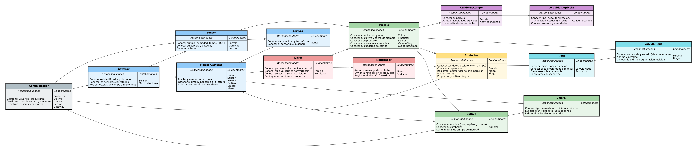
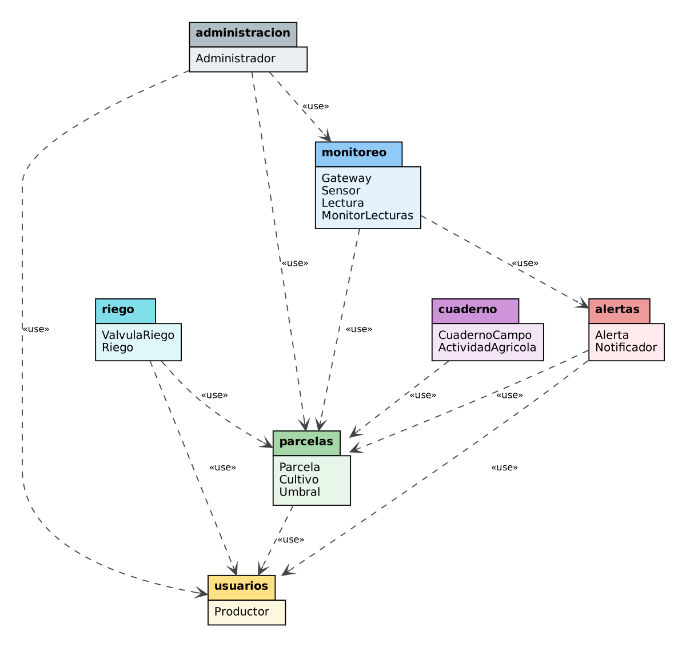

# Laboratorio 05 – Diseño y Arquitectura: AgroSmart

**Curso:** Ingeniería de Software II  
**Grupo:** _5_  
**Integrantes:** _
REAID YUSEF BARRETO IBRAHIM,
ALESSANDRA COSETTE MAÑUICO JAUREGUI,
ALVARO DIEGO MERA INCIO,
DAVID EDUARDO VILELA RIVERA_

---

## Pregunta 1: Tarjetas CRC y Paquetes

### 1.1 Clases candidatas

Se partió de los sustantivos del caso y se descartaron los que eran solo atributos (ubicación, área, fecha de siembra, insumos, cantidades) o sinónimos. Además, al hacer el *role-playing* apareció la necesidad de dos clases que no salen como sustantivo directo del caso: **MonitorLecturas** (alguien tiene que recibir la lectura y compararla con el umbral) y **Notificador** (alguien tiene que enviar el mensaje al productor).

Clases finales (15): `Productor`, `Administrador`, `Parcela`, `Cultivo`, `Umbral`, `Gateway`, `Sensor`, `Lectura`, `MonitorLecturas`, `Alerta`, `Notificador`, `ValvulaRiego`, `Riego`, `CuadernoCampo`, `ActividadAgricola`.

### 1.2 Tarjetas CRC

```
+---------------------------------------------------------------+
| Clase: Productor                                              |
+-------------------------------------+-------------------------+
| Conocer sus datos y teléfono        |                         |
| Conocer sus parcelas                | Parcela                 |
| Registrar/editar/dar de baja parcelas| Parcela                |
| Recibir alertas                     | Alerta                  |
| Programar y activar riegos          | Riego                   |
+-------------------------------------+-------------------------+

+---------------------------------------------------------------+
| Clase: Parcela                                                |
+-------------------------------------+-------------------------+
| Conocer su ubicación y área         |                         |
| Conocer su cultivo y fecha siembra  | Cultivo                 |
| Conocer a su productor              | Productor               |
| Conocer sus sensores y válvulas     | Sensor, ValvulaRiego    |
| Conocer su cuaderno de campo        | CuadernoCampo           |
+-------------------------------------+-------------------------+

+---------------------------------------------------------------+
| Clase: Cultivo                                                |
+-------------------------------------+-------------------------+
| Conocer su nombre                   |                         |
| Conocer sus umbrales                | Umbral                  |
| Dar el umbral de un tipo de medición| Umbral                  |
+-------------------------------------+-------------------------+

+---------------------------------------------------------------+
| Clase: Umbral                                                 |
+-------------------------------------+-------------------------+
| Conocer tipo de medición, mín y máx |                         |
| Evaluar si un valor está fuera rango|                         |
| Indicar si la desviación es crítica |                         |
+-------------------------------------+-------------------------+

+---------------------------------------------------------------+
| Clase: Gateway                                                |
+-------------------------------------+-------------------------+
| Conocer su id y ubicación           |                         |
| Conocer los sensores conectados     | Sensor                  |
| Recibir lecturas y reenviarlas      | MonitorLecturas         |
+-------------------------------------+-------------------------+

+---------------------------------------------------------------+
| Clase: Sensor                                                 |
+-------------------------------------+-------------------------+
| Conocer su tipo                     |                         |
| Conocer su parcela y gateway        | Parcela, Gateway        |
| Generar lecturas                    | Lectura                 |
+-------------------------------------+-------------------------+

+---------------------------------------------------------------+
| Clase: Lectura                                                |
+-------------------------------------+-------------------------+
| Conocer valor, unidad y fecha/hora  |                         |
| Conocer el sensor que la generó     | Sensor                  |
+-------------------------------------+-------------------------+

+---------------------------------------------------------------+
| Clase: MonitorLecturas                                        |
+-------------------------------------+-------------------------+
| Recibir y almacenar lecturas        | Lectura                 |
| Obtener el umbral aplicable         | Sensor, Parcela,        |
|                                     | Cultivo, Umbral         |
| Solicitar la creación de una alerta | Alerta                  |
+-------------------------------------+-------------------------+

+---------------------------------------------------------------+
| Clase: Alerta                                                 |
+-------------------------------------+-------------------------+
| Conocer parcela, valor y umbral     | Parcela                 |
| Conocer su nivel (crítica/advert.)  |                         |
| Conocer su estado (enviada, leída)  |                         |
| Pedir que se notifique al productor | Notificador             |
+-------------------------------------+-------------------------+

+---------------------------------------------------------------+
| Clase: Notificador                                            |
+-------------------------------------+-------------------------+
| Armar el mensaje de la alerta       | Alerta                  |
| Enviar la notificación              | Productor               |
| Registrar si el envío fue exitoso   |                         |
+-------------------------------------+-------------------------+

+---------------------------------------------------------------+
| Clase: ValvulaRiego                                           |
+-------------------------------------+-------------------------+
| Conocer su parcela y estado         | Parcela                 |
| Abrirse y cerrarse                  |                         |
| Conocer la última programación      | Riego                   |
+-------------------------------------+-------------------------+

+---------------------------------------------------------------+
| Clase: Riego                                                  |
+-------------------------------------+-------------------------+
| Conocer fecha, hora y duración      |                         |
| Conocer si es programado o manual   |                         |
| Ejecutarse sobre la válvula         | ValvulaRiego            |
| Cancelarse / suspenderse            |                         |
| Conocer quién lo programó           | Productor               |
+-------------------------------------+-------------------------+

+---------------------------------------------------------------+
| Clase: CuadernoCampo                                          |
+-------------------------------------+-------------------------+
| Conocer su parcela                  | Parcela                 |
| Agregar actividades agrícolas       | ActividadAgricola       |
| Listar actividades por fecha        | ActividadAgricola       |
+-------------------------------------+-------------------------+

+---------------------------------------------------------------+
| Clase: ActividadAgricola                                      |
+-------------------------------------+-------------------------+
| Conocer tipo y fecha                |                         |
| Conocer insumos y cantidades        |                         |
| Conocer a qué cuaderno pertenece    | CuadernoCampo           |
+-------------------------------------+-------------------------+

+---------------------------------------------------------------+
| Clase: Administrador                                          |
+-------------------------------------+-------------------------+
| Gestionar usuarios                  | Productor               |
| Gestionar cultivos y umbrales       | Cultivo, Umbral         |
| Registrar sensores y gateways       | Sensor, Gateway         |
+-------------------------------------+-------------------------+
```

### 1.3 Gráfico de tarjetas y colaboraciones

Cada tarjeta muestra nombre, responsabilidades y colaboradores. Las flechas van de la clase que pide ayuda hacia su colaborador. Los colores agrupan las tarjetas que luego quedan en el mismo paquete.



> Fuente editable: `src/crc.dot` (Graphviz).

### 1.4 Simulación (*role-playing*)

**Escenario:** un sensor de humedad envía una lectura de 12 % en una parcela de espárrago cuyo umbral mínimo es 18 %.

1. **Sensor** (humedad del suelo, parcela P-07) genera una **Lectura** con valor 12 % y la manda a su **Gateway**.
2. **Gateway** reenvía la lectura a **MonitorLecturas**.
3. **MonitorLecturas** almacena la **Lectura** y le pregunta al **Sensor** a qué parcela pertenece → P-07.
4. **MonitorLecturas** le pregunta a la **Parcela** P-07 su cultivo → espárrago.
5. **MonitorLecturas** le pide al **Cultivo** "espárrago" el umbral de *humedad del suelo* → **Umbral** (mín 18 %, máx …).
6. **MonitorLecturas** le pide al **Umbral** que evalúe 12 %. El Umbral responde: *fuera de rango, crítica* (por debajo del mínimo).
7. **MonitorLecturas** crea una **Alerta** con la parcela P-07, valor 12 %, umbral 18 % y nivel crítico.
8. **Alerta** le pide al **Notificador** que avise.
9. **Notificador** obtiene de la **Parcela** a su **Productor**, arma el mensaje (“Humedad del suelo en P-07: 12 %, mínimo 18 %”) y lo envía al teléfono del productor.
10. **Notificador** registra que el envío fue exitoso y la **Alerta** cambia su estado a *enviada*.

**Lo que salió de la simulación:**
- Al inicio nadie tenía la responsabilidad de "comparar lectura vs. umbral"; ponerla en `Lectura` o en `Sensor` no tenía sentido porque ninguno conoce el cultivo. Por eso se creó **MonitorLecturas**.
- `Alerta` estaba enviando el mensaje ella misma, lo que mezclaba datos con integración externa (WhatsApp). Se separó en **Notificador**.
- `Umbral` originalmente solo "sabía" mín/máx; se le agregó la responsabilidad de *evaluar* el valor para que MonitorLecturas no tenga esa lógica.

---

### 1.5 Diagrama de paquetes



> Fuente PlantUML: `src/paquetes.puml` (también se incluye `src/paquetes.dot`).

```plantuml
@startuml
skinparam packageStyle folder
package "administracion" { class Administrador }
package "usuarios"       { class Productor }
package "parcelas"       { class Parcela
                           class Cultivo
                           class Umbral }
package "monitoreo"      { class Gateway
                           class Sensor
                           class Lectura
                           class MonitorLecturas }
package "alertas"        { class Alerta
                           class Notificador }
package "riego"          { class ValvulaRiego
                           class Riego }
package "cuaderno"       { class CuadernoCampo
                           class ActividadAgricola }

administracion ..> usuarios  : <<use>>
administracion ..> parcelas  : <<use>>
administracion ..> monitoreo : <<use>>
parcelas  ..> usuarios  : <<use>>
monitoreo ..> parcelas  : <<use>>
monitoreo ..> alertas   : <<use>>
alertas   ..> parcelas  : <<use>>
alertas   ..> usuarios  : <<use>>
riego     ..> parcelas  : <<use>>
riego     ..> usuarios  : <<use>>
cuaderno  ..> parcelas  : <<use>>
@enduml
```

### 1.6 Verificación de dependencias cíclicas

El diagrama final **no tiene ciclos**: `usuarios` no depende de nadie, `parcelas` solo depende de `usuarios`, y el resto depende "hacia abajo". Pero en la primera versión sí aparecieron ciclos, porque las tarjetas CRC tienen colaboraciones en ambos sentidos:

| Ciclo detectado | Causa | Cómo se resolvió |
|---|---|---|
| `usuarios ↔ parcelas` | `Productor` conoce sus parcelas y `Parcela` conoce a su productor. | Se dejó la navegación en un solo sentido: `Parcela` guarda la referencia a su `Productor`. Para "listar las parcelas de un productor" se consulta por `productorId` dentro de `parcelas`. |
| `parcelas ↔ monitoreo / riego / cuaderno` | `Parcela` conoce sus sensores, válvulas y cuaderno, y estos conocen su parcela. | Igual: `Sensor`, `ValvulaRiego` y `CuadernoCampo` guardan la referencia a su parcela; `Parcela` no los referencia directamente. |
| `monitoreo ↔ alertas` | Se pensó que `Alerta` guardara la `Lectura` completa. | `Alerta` guarda una copia del valor medido, el tipo y la fecha (no el objeto `Lectura`). |
| `usuarios ↔ parcelas / monitoreo` (por el administrador) | `Administrador` estaba en `usuarios` y gestiona cultivos y sensores. | Se movió `Administrador` a un paquete propio `administracion`, que solo depende de los demás. |

### 1.7 Justificación de paquetes

- **usuarios:** contiene a `Productor`. Es la base de la que dependen casi todos (dueño de parcelas, destinatario de alertas, quien programa riegos), por eso no debe depender de nadie.
- **administracion:** agrupa las funciones del administrador de la cooperativa (usuarios, cultivos/umbrales, sensores/gateways). Cambia por razones administrativas y se separó para no generar ciclos.
- **parcelas:** `Parcela`, `Cultivo` y `Umbral` forman el núcleo agronómico. El umbral depende del cultivo y el cultivo de la parcela; casi siempre se usan juntos.
- **monitoreo:** todo lo relacionado a la captura de datos de campo (`Gateway`, `Sensor`, `Lectura`, `MonitorLecturas`). Es la parte con más carga (lecturas cada 5 min) y podría escalarse por separado.
- **alertas:** `Alerta` y `Notificador`. Aísla la integración con el canal externo (WhatsApp); si cambia el canal solo se toca este paquete.
- **riego:** `ValvulaRiego` y `Riego`. Agrupa el control de actuadores físicos, que tiene reglas propias de seguridad y de funcionamiento sin conexión.
- **cuaderno:** `CuadernoCampo` y `ActividadAgricola`. Es la parte de trazabilidad, que se usa de forma independiente al monitoreo (registro manual, exportar PDF).

---

## Pregunta 2: Requisitos Arquitectónicamente Significativos y Atributos de Calidad

### 2.1 Requisitos arquitectónicamente significativos (ASR)

| ID | ¿Por qué es arquitectónicamente significativo? | Posible decisión arquitectónica |
|----|------------------------------------------------|---------------------------------|
| **RNF01** | Obliga a que la app móvil tenga almacenamiento local y lógica de sincronización y resolución de conflictos. Cambia la estructura de la app y la API; es muy difícil de agregar después. | Arquitectura *offline-first*: base de datos local (SQLite/Room/Realm), cola de operaciones pendientes y sincronización en segundo plano con IDs generados en el cliente (UUID) y política de conflictos (*last-write-wins* por registro). |
| **RNF02** | Define la capacidad de ingesta (5 000 → 50 000 sensores). Determina el estilo de recepción de datos y el tipo de base de datos; una mala elección obliga a rehacer el backend. | Ingesta asíncrona con *message broker* (MQTT/Kafka) entre gateways y backend, servicio de ingesta escalable horizontalmente y base de datos de series de tiempo (TimescaleDB/InfluxDB). |
| **RNF03** | Impone un tiempo de respuesta extremo a extremo (< 1 min) que atraviesa ingesta, evaluación y un servicio externo. No se puede cumplir con procesamiento por lotes. | Procesamiento en *stream* / arquitectura orientada a eventos: la evaluación de umbrales se hace al llegar cada lectura (evento `LecturaRecibida` → `AlertaGenerada`), con cola prioritaria para alertas críticas. |
| **RNF04** | Afecta cómo se reparten las responsabilidades entre la nube y el campo: la lógica de riego no puede vivir solo en el servidor. Involucra hardware. | *Edge computing*: el gateway/controlador de válvulas guarda localmente la última programación y la ejecuta de forma autónoma; la nube solo envía programaciones. |
| **RNF05** | Control de un actuador físico: un acceso indebido puede desperdiciar agua o dañar el cultivo. Atraviesa todas las capas (app, API, gateway). | Autenticación con OAuth2/JWT, autorización basada en recursos (el usuario debe ser dueño de la parcela) y comunicación cifrada y autenticada con el gateway (TLS/mTLS). |
| **RNF06** | Pide aislar proveedores externos de la lógica de negocio. Si no se decide al inicio, el código de IA/clima queda acoplado en todas partes. | Arquitectura hexagonal (puertos y adaptadores) con patrón *Adapter* / *Strategy*: interfaces `ServicioClima`, `ModeloVision`, `ModeloPrediccion` y un adaptador por proveedor. |
| **RF02** | Es la fuente de datos de todo el sistema (alertas, recomendaciones, históricos) e involucra la integración con dispositivos externos (gateways). | Protocolo de comunicación con gateways (MQTT) y un componente de ingesta independiente. Se trabaja junto con RNF02. |
| **RF03** | Integra un servicio externo (WhatsApp Business API) que tiene sus propias restricciones (plantillas, límites, costos) y del que depende el RNF03. | Componente de notificaciones desacoplado mediante cola, con adaptador para WhatsApp y reintentos. |
| **RF05** | Requiere un modelo de IA de visión (externo o propio), subida de imágenes desde zonas con mala conexión y almacenamiento de archivos. | Almacenamiento de objetos (S3 o similar) para fotos, procesamiento asíncrono de la inferencia y adaptador al proveedor del modelo (relacionado con RNF06 y RNF01). |
| **RF06** | Depende de un servicio externo y además modifica el comportamiento de otro componente (riego). | Tarea programada (*scheduler*) diaria que consulta el clima vía adaptador y publica un evento `LluviaPronosticada` que el módulo de riego consume. |
| **RF07** | Necesita datos históricos, clima y un modelo predictivo; implica un *pipeline* de datos distinto al transaccional. | Procesamiento *batch* semanal separado del flujo en tiempo real, con acceso a la base de series de tiempo y adaptador al modelo de predicción. |

**Requisitos que NO consideramos arquitectónicamente significativos:**

- **RF01 (registrar, editar y dar de baja parcelas):** es un CRUD típico. Se resuelve con cualquier arquitectura y no implica riesgo técnico ni integración externa.
- **RF08 (cuaderno de campo y exportar a PDF):** registrar actividades también es un CRUD, y generar un PDF se resuelve con una librería. Si cambia la librería no afecta la estructura del sistema. (Lo que sí es significativo es que el registro funcione sin conexión, pero eso ya está cubierto por RNF01).
- **RF04 (programar riegos y activar válvulas):** como funcionalidad es simple; lo arquitectónicamente relevante ya está capturado por RNF04 y RNF05, por eso no lo pusimos como ASR por separado.

---

### 2.2 Atributos de calidad y escenarios

#### a) Disponibilidad
**Se deriva de:** RNF04, RNF01 (y la cobertura intermitente del caso).

| Parte | Descripción |
|---|---|
| Fuente del estímulo | Falla interna de la plataforma / caída de la conexión a internet del gateway |
| Estímulo | La plataforma deja de responder durante 3 horas |
| Artefacto | Controlador de válvulas de riego en el gateway |
| Entorno | Operación normal, con un riego programado para las 6:00 a. m. |
| Respuesta | El gateway ejecuta el riego con la última programación recibida y guarda el registro para enviarlo cuando vuelva la conexión |
| Medida de la respuesta | 100 % de los riegos programados se ejecutan durante la caída; los registros se sincronizan en menos de 5 min después de restablecerse la conexión |

#### b) Rendimiento (tiempo de respuesta)
**Se deriva de:** RNF03, RF03.

| Parte | Descripción |
|---|---|
| Fuente del estímulo | Sensor de humedad del suelo (a través del gateway) |
| Estímulo | Llega una lectura de 12 % en una parcela con mínimo de 18 % |
| Artefacto | Servicio de evaluación de umbrales y servicio de notificaciones |
| Entorno | Operación normal, con 5 000 sensores enviando datos |
| Respuesta | Se genera una alerta crítica y se envía por WhatsApp al productor |
| Medida de la respuesta | Notificación entregada en < 60 s desde la recepción de la lectura en el 99 % de los casos |

#### c) Escalabilidad
**Se deriva de:** RNF02, RF02.

| Parte | Descripción |
|---|---|
| Fuente del estímulo | Incorporación de nuevas cooperativas de la región |
| Estímulo | El número de sensores pasa de 5 000 a 50 000 |
| Artefacto | Servicio de ingesta de lecturas y base de datos de series de tiempo |
| Entorno | Operación normal / pico (todas las lecturas llegan en la misma ventana de 5 min) |
| Respuesta | El sistema agrega instancias del servicio de ingesta sin cambios en el código |
| Medida de la respuesta | 0 lecturas perdidas; latencia de almacenamiento < 10 s; escalado sin tiempo de inactividad |

#### d) Seguridad
**Se deriva de:** RNF05.

| Parte | Descripción |
|---|---|
| Fuente del estímulo | Usuario autenticado que no es dueño de la parcela (o un atacante externo) |
| Estímulo | Intenta activar la válvula de riego de la parcela P-07 |
| Artefacto | API de control de riego |
| Entorno | Operación normal |
| Respuesta | La solicitud se rechaza, la válvula no se activa y se registra el intento en el log de auditoría |
| Medida de la respuesta | 100 % de intentos no autorizados bloqueados; respuesta HTTP 403 en < 1 s; evento registrado |

#### e) Modificabilidad
**Se deriva de:** RNF06, RF05, RF06, RF07.

| Parte | Descripción |
|---|---|
| Fuente del estímulo | La cooperativa (decisión de negocio por costos) |
| Estímulo | Se decide cambiar el proveedor de clima de OpenWeather a SENAMHI |
| Artefacto | Adaptador del servicio de clima |
| Entorno | Tiempo de desarrollo |
| Respuesta | Se implementa un nuevo adaptador y se cambia la configuración, sin tocar la lógica de suspensión de riegos |
| Medida de la respuesta | 0 cambios en clases del dominio; cambio implementado y desplegado en ≤ 3 días-persona |

#### f) Usabilidad / operación sin conexión
**Se deriva de:** RNF01, RF05, RF08 (productores en campo, cobertura intermitente).

| Parte | Descripción |
|---|---|
| Fuente del estímulo | Productor en su parcela |
| Estímulo | Registra una fumigación y toma una foto de una hoja sin señal móvil |
| Artefacto | Aplicación móvil |
| Entorno | Sin conexión a internet |
| Respuesta | La app guarda la actividad y la foto localmente, muestra que está "pendiente de sincronizar" y las envía sola al recuperar la conexión |
| Medida de la respuesta | 0 datos perdidos; sincronización automática en < 2 min tras recuperar señal, sin acción del usuario |

#### g) Interoperabilidad
**Se deriva de:** RF02, RF03, RF06 (gateways, WhatsApp, servicio de clima).

| Parte | Descripción |
|---|---|
| Fuente del estímulo | Servicio externo de clima |
| Estímulo | La consulta diaria devuelve un pronóstico de lluvia para mañana en el valle de Ica |
| Artefacto | Componente de integración con clima y módulo de riego |
| Entorno | Operación normal (ejecución programada diaria) |
| Respuesta | El sistema interpreta la respuesta y suspende los riegos programados de las parcelas afectadas, notificando al productor |
| Medida de la respuesta | Riegos suspendidos antes de su hora de inicio en el 100 % de los casos con pronóstico de lluvia |

---

### 2.3 Priorización y *trade-offs*

**Priorización** (de mayor a menor importancia para el negocio):

1. **Disponibilidad** – si las válvulas dejan de regar, se pierde el cultivo; es el impacto económico más directo.
2. **Seguridad** – se controlan actuadores físicos y agua, que es un recurso escaso.
3. **Rendimiento** – las alertas críticas pierden valor si llegan tarde.
4. **Usabilidad / operación sin conexión** – sin esto los productores no podrán usar la app en campo y no habrá trazabilidad.
5. **Escalabilidad** – es importante a mediano plazo (otras cooperativas), pero hoy son 5 000 sensores.
6. **Modificabilidad** – reduce costos futuros, pero no afecta al productor en el día a día.
7. **Interoperabilidad** – necesaria, pero se cubre en buena parte con las decisiones de modificabilidad.

**Trade-offs:**

1. **Rendimiento (RNF03) vs. Modificabilidad (RNF06).** Poner capas de abstracción (puertos, adaptadores, colas) entre la lógica de negocio y los servicios externos agrega saltos y latencia. Además, si para cambiar de proveedor de mensajería se usa un intermediario genérico, el envío puede ser más lento que llamar directamente a la API de WhatsApp. Para cumplir el minuto hay que mantener el flujo de alertas críticas corto (evaluación en memoria al llegar la lectura) y aceptar que el adaptador sea delgado, aunque eso dé un poco menos de flexibilidad.

2. **Disponibilidad (RNF04) vs. Seguridad (RNF05).** Para que las válvulas funcionen sin la plataforma, el gateway debe decidir solo. Pero si la plataforma no está, el gateway no puede validar contra el servidor si quien da una orden local está autorizado ni si la programación fue revocada. Se resuelve parcialmente permitiendo que el gateway solo ejecute la última programación firmada por el servidor y rechace órdenes nuevas mientras esté desconectado, lo que reduce la disponibilidad de la activación manual.

3. **Usabilidad offline (RNF01) vs. consistencia / seguridad de datos.** Guardar datos localmente en el celular permite trabajar sin señal, pero implica posibles conflictos (dos personas editando el mismo cuaderno) y datos sensibles almacenados en el dispositivo. Se acepta consistencia eventual y se debe cifrar el almacenamiento local.

4. **Escalabilidad (RNF02) vs. costo / simplicidad.** Un broker de mensajes y servicios escalables horizontalmente encarecen y complican la infraestructura para una cooperativa de 120 productores. Se puede empezar con una configuración pequeña, pero diseñando los componentes para escalar después.
